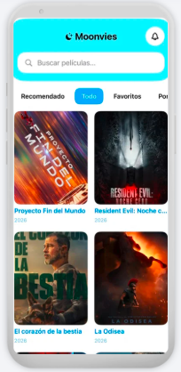
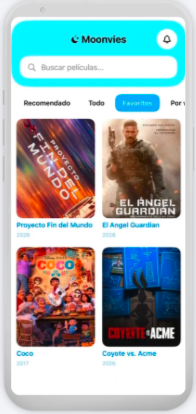
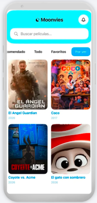
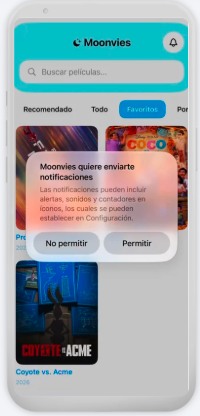

# Moonvies

Aplicación iOS para descubrir películas, buscarlas, consultar su información y llevar una lista personal de favoritas y pendientes por ver. Usa la API de TMDB.

---

## Descripción

Cuando alguien quiere ver una película suele saltar entre varias páginas para saber de qué trata, cómo la califican y si ya la había apuntado. Además, las películas que "dejamos para después" se olvidan.

**Moonvies** reúne todo en una sola app:

- Muestra el catálogo de películas populares de TMDB con póster, año y calificación.
- Permite buscar cualquier película de TMDB.
- Guarda en el teléfono las películas favoritas y las que están **Por ver**.
- Envía un recordatorio cuando una película lleva 2 semanas pendiente.

---

## Funcionalidades

### MVP

- **Catálogo de películas** desde TMDB (`GET /3/movie/popular`) con póster, título, año y calificación.
- **Pestaña Recomendado:** "Mejor valorada hoy" y "Top de la semana".
- **Pestaña Todo:** catálogo completo con botón **Cargar más** (paginación sin repetir películas).
- **Búsqueda** en TMDB (`GET /3/search/movie`) mientras se escribe.
- **Búsqueda sin resultados:** mensaje y botón "Intentar nuevamente".
- **Detalle de película:** póster, fecha de estreno, calificación, sinopsis y sugerencias.
- **Favoritos:** agregar y quitar, con límite de 20 y mensajes de confirmación o error.
- **Persistencia local** de favoritos y Por ver con SwiftData (no se pierden al cerrar la app).
- **Estados de interfaz:** cargando, error con "Reintentar", catálogo vacío, sin resultados, favoritos vacíos y Por ver vacío.

### Funcionalidades adicionales

- **Por ver:** lista de películas para ver después, guardada en el dispositivo.
- **Recordatorios:** notificación local cuando una película lleva 2 semanas en Por ver.
- **Pantalla de Notificaciones:** se abre con la campana de Home, que muestra cuántos recordatorios hay pendientes.
- **Accesibilidad:** etiquetas, traits y hints para VoiceOver (ver [`Docs/accessibility.md`](Docs/accessibility.md)).

---

## Capturas de pantalla

| Home: Todo | Home: Favoritos | Home: Por ver | Permiso de notificaciones |
|---|---|---|---|
|  |  |  |  |

---

## Tecnologías

| Tecnología | Uso |
|---|---|
| **Swift** | Lenguaje de la app |
| **SwiftUI** | Toda la interfaz |
| **Observation** (`@Observable`) | Estado de ViewModels y stores |
| **URLSession + async/await** | Consumo de la API de TMDB |
| **Codable** | Lectura del JSON de TMDB |
| **SwiftData** | Persistencia local de favoritos y Por ver |
| **UserNotifications** | Recordatorios locales de Por ver |
| **XCTest y Swift Testing** | Pruebas unitarias con mocks |
| **Xcode** | Desarrollo, simulador y pruebas |
| **TMDB API v3** | Fuente de datos de películas |

---

## Requisitos

| Requisito | Versión |
|---|---|
| macOS | Una versión compatible con Xcode 26 |
| Xcode | 26 o superior |
| iOS (deployment target) | 26.5 |
| Simulador o iPhone | Con iOS 26.5 o superior |
| Cuenta de TMDB | Gratuita, para obtener el token de la API |
| Conexión a internet | Para cargar el catálogo y buscar |

---

## Instalación y configuración

1. Clona el repositorio:

   ```bash
   git clone https://github.com/NorbertoRuizCarbajal/AlgodonMoonvies.git
   cd AlgodonMoonvies
   ```

2. Configura el token de TMDB (ver la sección [Configuración de servicios externos](#configuración-de-servicios-externos)).

---

## Ejecución

1. Abre `Moonvies.xcodeproj` en Xcode.
2. Elige el esquema **Moonvies** y un simulador de iPhone.
3. Ejecuta la app con **Cmd + R**.
4. La primera vez que agregues una película a **Por ver**, iOS pedirá permiso para enviar notificaciones.

### Pruebas

- Ejecuta las pruebas unitarias con **Cmd + U**.
- Revisa los resultados en el navegador de pruebas (**Cmd + 6**).

### Probar los recordatorios sin esperar 2 semanas

En `Moonvies/Models/WatchlistReminder.swift` cambia `minimumDays` de `14` a `0`. Al agregar una película a Por ver, la notificación llega a los 5 segundos y la película aparece en la pantalla Notificaciones. Después regrésalo a `14`.

---

## Configuración de servicios externos

La app usa la **API v3 de TMDB** con autenticación por token Bearer.

1. Crea una cuenta en [themoviedb.org](https://www.themoviedb.org/).
2. Ve a **Ajustes → API** y copia el **API Read Access Token**. Es el token largo, no la "API Key" corta.
3. Copia la plantilla `Docs/Secrets.example.swift` a la carpeta `Moonvies/Config/` y renómbrala como `Secrets.swift`.
4. Dentro de `Secrets.swift`, reemplaza `PEGA_AQUI_TU_TOKEN` por tu token:

   ```swift
   import Foundation

   enum Secrets {
       static let tmdbToken = "PEGA_AQUI_TU_TOKEN"
   }
   ```

`Secrets.swift` está en el `.gitignore`: **nunca subas tu token al repositorio**.

Si el token falta, la app muestra *"Falta el token de TMDB. Pégalo en Secrets.swift."*. Si el token es incorrecto, muestra *"El token de TMDB no es válido (error 401)."*.

---

## Documentación

| Documento | Contenido |
|---|---|
| [`Docs/technical-documentation.md`](Docs/technical-documentation.md) | Arquitectura, networking, persistencia, decisiones técnicas y limitaciones conocidas |
| [`Docs/navigation-and-state.md`](Docs/navigation-and-state.md) | Pantallas, navegación y estados de la interfaz |
| [`Docs/mvvm-proposal.md`](Docs/mvvm-proposal.md) | Propuesta de arquitectura MVVM |
| [`Docs/refactor-mvvm.md`](Docs/refactor-mvvm.md) | Refactorización a MVVM |
| [`Docs/testing-and-persistence.md`](Docs/testing-and-persistence.md) | Pruebas y persistencia |
| [`Docs/accessibility.md`](Docs/accessibility.md) | Accesibilidad con VoiceOver |

---

## Integrantes

**Equipo 14**

- Sánchez Baños Lizeth Marisol
- Ruiz Carbajal Norberto
- Ávila Aguilar Alberto
